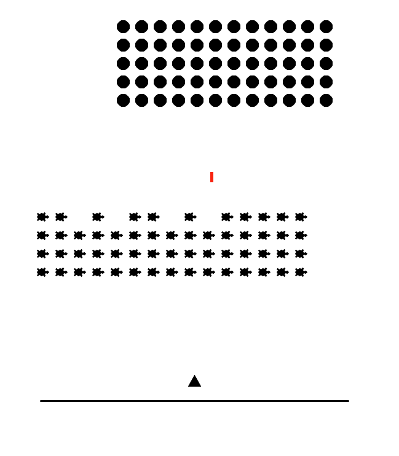
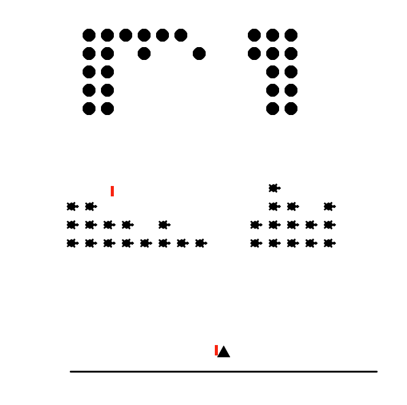
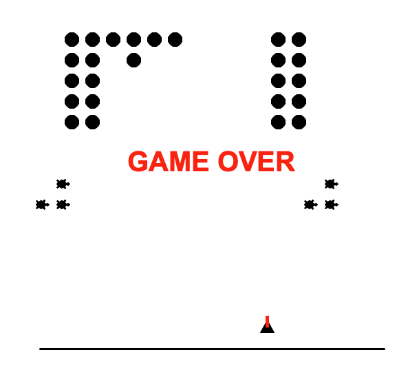

# Space Invaders Game 🚀

A classic Space Invaders-style arcade game built with Python and the Turtle graphics library. Control your spaceship, shoot incoming aliens, dodge enemy fire, and destroy all the aliens to win!

## 🎮 Overview

This project recreates the core gameplay of the classic Space Invaders arcade game. It uses Python's Turtle graphics, object-oriented programming, keyboard event handling, and collision detection to create an interactive game.

The project is organized into separate Python modules to keep the player, bullets, and barriers independent from the main game logic.

## ✨ Features

- **Player Movement:** Move the spaceship left and right using the arrow keys.
- **Shooting Mechanics:** Fire bullets using the spacebar.
- **Alien Movement:** Aliens move horizontally and descend when they reach the screen boundaries.
- **Enemy Attacks:** Aliens periodically shoot bullets toward the player.
- **Collision Detection:** Detect interactions between bullets, aliens, barriers, and the player.
- **Barriers:** Defensive barriers can be destroyed by alien attacks.
- **Win Condition:** Destroy all aliens to win the game.
- **Game Over:** The game ends when an alien or an enemy bullet hits the player.

## 🛠️ Technologies Used

- **Python 3**
- **Turtle Graphics** — game graphics and screen rendering
- **Random** — random selection of aliens to shoot
- **Time** — timing and movement delays

## 📁 Project Structure

```text
space_inavaders_game/
│
├── main.py          # Main game logic and game loop
├── space.py         # Player spaceship
├── bullets.py       # Player bullet behavior
├── alienbullet.py   # Alien bullet behavior
├── barriers.py      # Defensive barriers
└── README.md        # Project documentation
```

## ⚙️ Installation

### 1. Install Python

Install Python 3 if it is not already installed.

Download it from [python.org](https://www.python.org/downloads/).

### 2. Clone the Repository

Open your terminal and run:

```bash
git clone https://github.com/bhoomipanchal4/space_inavaders_game.git
```

### 3. Navigate to the Project Folder

```bash
cd space_inavaders_game
```

### 4. Run the Game

```bash
python3 main.py
```

**Note:** The game uses Python's built-in Turtle library, so no additional third-party packages are required. A desktop environment that supports Turtle graphics is needed.

## 🕹️ How to Play

| Key | Action |
|---|---|
| ← Left Arrow | Move spaceship left |
| → Right Arrow | Move spaceship right |
| Spacebar | Fire a bullet |

**Objective:** Destroy all the aliens while avoiding enemy bullets and protecting your spaceship.

## 📸 Screenshots








## 👩‍💻 Author

**Bhoomi Panchal**

